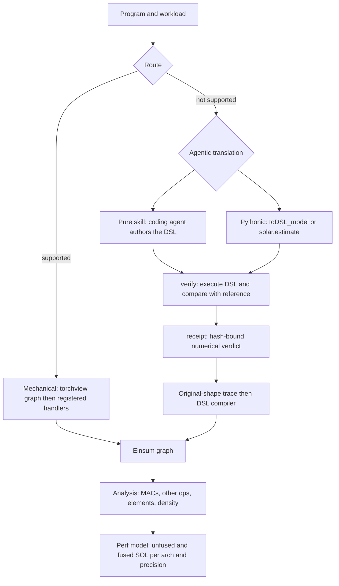

<!-- SPDX-FileCopyrightText: Copyright (c) 2025 NVIDIA CORPORATION & AFFILIATES. All rights reserved. -->
<!-- SPDX-License-Identifier: Apache-2.0 -->

# SOLAR: program-to-Einsum speed-of-light analysis

SOLAR estimates a speed-of-light (SOL) roofline bound for a program from its
computation and data movement. A program enters through one of **two frontend
routes**, and both routes feed **one shared Einsum analysis backend**:

- **Mechanical lowering** for supported PyTorch programs: torchview graph
  extraction plus registered operator-to-Einsum handlers. No agent, no API.
- **Execution-validated agentic translation** for programs the mechanical
  route cannot lower (other PyTorch operators, JAX, Triton, CUDA/CuTeDSL).
  A coding agent following the shipped skill (**pure-skill** workflow), or a
  Python orchestrator calling an inference API (**Pythonic** workflow),
  authors an executable `einsum_lib` DSL program. The DSL is executed and
  compared numerically against an executable reference before analysis.

A SOL number is conditional on its operation counts, its access model and its
hardware assumptions. Numerical agreement of a translation, correct counting
and a valid hardware model are three separate checks. None implies the others,
and none is measured latency.

## How the pieces fit



The route is chosen by the caller. Two offline helpers assist:
`python3 -m solar.frontend.router` inspects an extracted graph and routes it
`mechanical` only on positive evidence, and `solar.estimate.estimate` tries
the mechanical frontend first and falls back only on a typed unsupported
error. Neither is a universal dispatcher; see
[route selection](docs/SOLAR_FLOW.md) for what each one actually checks.

## Quickstart

### Install

```bash
# From the repository root (Python 3.10+, torch >= 2.7.1):
bash install.sh                              # clones torchview @ edbe1fa, applies the shipped patch, installs dependencies
python3 -m pip install -e ".[verify]"        # editable install; [verify] adds numba (fast DSL execution) and psutil
# Or install the built distribution (sdist/wheel) with dependency resolution:
python3 -m pip install "solar[verify]" --find-links dist/
```

Both layouts are supported. In a checkout, run the commands below from its
root. From a wheel install there is no checkout: the configs, skills,
scripts, patches and examples are packaged, and `solar-resource <path>`
(`python3 -m solar.resources`) prints where a resource lives, for example
`python3 "$(solar-resource scripts/verify_saved_ir.py)" ...`. If more than
one SOLAR is installed, check `python3 -c "import solar; print(solar.__file__)"`
first; the helper scripts under `scripts/` import whichever `solar` is
installed (see [troubleshooting](docs/TROUBLESHOOTING.md)).

### Mechanical route on a supported PyTorch model

```bash
OUT=$(mktemp -d)
MODEL=examples/TwoInputMatmul/TwoInputMatmul.py
python3 -m solar.cli.process_model --model-file "$MODEL" --output-dir "$OUT/graph"
python3 -m solar.frontend.router "$OUT/graph/pytorch_graph.yaml"
python3 -m solar.cli.toeinsum_model --graph-path "$OUT/graph/pytorch_graph.yaml" \
    --output-dir "$OUT/einsum" --enable-rename
python3 -m solar.cli.analyze_model --einsum-graph-path "$OUT/einsum/einsum_graph_renamed.yaml" \
    --output-dir "$OUT/analysis" --no-copy-graph
python3 -m solar.cli.predict_perf_model --analysis-path "$OUT/analysis/analysis.yaml" \
    --output-dir "$OUT/perf" --arch-config B200 --precision fp16
```

Expected: the router prints `"route": "mechanical"`, `analysis/analysis.yaml`
reports `total.macs: 262144` (32 x 64 x 128) and `total.unfused_elements:
14336`, and `perf/perf_B200.yaml` reports `unfused.memory_bytes: 28672`.
The full command reference, a learned-parameter example and an audited
attention example are in [the mechanical route page](docs/SOLAR_V1_FLOW.md).

**SOL assumptions: sparse vs dense peak.** Each `configs/arch/<name>.yaml`
carries both the dense and the structured-sparsity tensor-core peak for every
precision it declares, with their sources. `--sol-mode {sparse,dense}` (also
`sol_mode=` in the Python API) selects which set prices the headline SOL;
the default is **sparse**. The sparse SOL assumes the workload is eligible for
the 2:4 structured-sparsity tensor-core rate and is a lower bound no dense
kernel can reach; the **dense SOL is the more realistic estimate** for dense
work. Every `perf_<arch>.yaml` and `result.json` carries both as
`sol_sparse` / `sol_dense` next to `sol_mode`; see
[configs/arch/README.md](configs/arch/README.md) and
[docs/SOL_GUIDE.md](docs/SOL_GUIDE.md) ("Sparse vs dense tensor-core peak").

### Agentic route: deterministic tools on the shipped example

The skill route's tools need no API key. The shipped RMSNorm example carries
an adapter (reference) and a hand-authored DSL:

```bash
M=skills/verified-translation/example
OUT=$(mktemp -d)
python3 -m solar.cli.translate verify "$M/adapter.py" "$M/solar_model_einsum_lib.py" \
    --source-type cuda --mem-budget 8
python3 -m solar.cli.translate sol "$M/solar_model_einsum_lib.py" --definition "$M" \
    --fallback-adapter "$M/adapter.py" --out-dir "$OUT/sol" --arch B200 --precision fp16
```

Expected: `verify` ends with `VERIFIED  (max_abs_error=3.411e-07, ...)`;
`sol` prints `validation: none (legacy, unvalidated)` and `SOL fused=...
macs=0`, and writes `dsl_full/`, `einsum_full/`, `analysis_full/analysis.yaml`
(`total.other_ops: 6144`), `perf_full/perf_B200.yaml` and `validation.json`.
The DSL was verified at B=8; the SOL is traced at the definition's B=24
workload. That is a structural, not a numerical, result. Add `--strict` to
`verify` to make shape-only or vacuous runs exit 3, and `--emit-receipt` /
`sol --strict --receipt ... --source-path ...` to gate the SOL on a receipt
bound to the verified bytes ([receipts](docs/RECEIPTS_AND_VALIDATION.md)).
For a new program, a coding agent follows
[the verified-translation skill](skills/verified-translation/SKILL.md);
`python3 -m solar.cli.translate scaffold` only creates the workspace.
See [the agentic route page](docs/SOLAR_V2_FLOW.md).

### Python API

```python
from solar.estimate import estimate

r = estimate("examples/TwoInputMatmul/TwoInputMatmul.py", "out", mode="v0",
             arch="B200", precision="fp16")
print(r.used_mode, int(r.macs), r.validation)
# v0 262144 {'kind': 'mechanical', 'numeric_comparison': False}
```

`estimate` writes a unique `run-<id>/` directory with `request.json`,
stage outputs and `result.json` or `failure.json`. The modes, the
`solar.translate` facade, receipts and the mechanical classes are documented
in [the Python API page](docs/PYTHON_API.md).

## What a result does and does not establish

| Verdict | Produced by | A pass means | A pass does not mean |
|---|---|---|---|
| Numerical | `verify`, `estimate` modes v1/v2, receipts | The DSL matched the reference on the prepared inputs at the effective tolerance | All inputs or shapes agree; counts are right |
| Structural | Trace and DSL compiler | Every loop extent resolved and every tensor is accounted for | The program does the work a kernel would do |
| Accounting | Analysis | MACs, other ops, elements and density follow the as-written convention | Traffic or schedule feasibility on real hardware |
| Hardware | Perf model | A roofline bound under one arch config, precision and fusion assumption | Measured latency or implementation efficiency |

Receipts record the numerical verdict together with `not_certified` for the
other three. [Receipts and validation](docs/RECEIPTS_AND_VALIDATION.md)
explains every field.

## Documentation

| Need | Page |
|---|---|
| Which route, what each decides, and what "supported" means | [docs/SOLAR_FLOW.md](docs/SOLAR_FLOW.md) |
| Mechanical commands with audited expected counts | [docs/SOLAR_V1_FLOW.md](docs/SOLAR_V1_FLOW.md) |
| Agentic commands: pure-skill and Pythonic, receipts, density | [docs/SOLAR_V2_FLOW.md](docs/SOLAR_V2_FLOW.md) |
| Python API: `solar.estimate`, `solar.translate`, router, receipts, classes | [docs/PYTHON_API.md](docs/PYTHON_API.md) |
| What verify, receipts, analysis and perf fields mean | [docs/RECEIPTS_AND_VALIDATION.md](docs/RECEIPTS_AND_VALIDATION.md) |
| Stage-by-stage implementation contracts and present gaps | [docs/SOLAR_V2_CONTRACTS.md](docs/SOLAR_V2_CONTRACTS.md) |
| What must be validated, and what a pass does not prove | [docs/SOLAR_V2_OVERVIEW.md](docs/SOLAR_V2_OVERVIEW.md#what-must-be-validated) |
| Bounded fallback dispatcher (`python -m solar.frontend.dispatcher`): routing contract, isolation, budgets | [docs/DISPATCHER.md](docs/DISPATCHER.md) |
| Library facade `solar.translate` and its artifact layout | [docs/V2_FLOW.md](docs/V2_FLOW.md) |
| Design rationale | [docs/SOLAR_V2_OVERVIEW.md](docs/SOLAR_V2_OVERVIEW.md) |
| Interpreting unfused / fused / prefetched SOL | [docs/SOL_GUIDE.md](docs/SOL_GUIDE.md) |
| Troubleshooting | [docs/TROUBLESHOOTING.md](docs/TROUBLESHOOTING.md) |
| Coding-agent skill for translation | [skills/verified-translation/SKILL.md](skills/verified-translation/SKILL.md) |
| Release notes and known limitations | [RELEASE_NOTES.md](RELEASE_NOTES.md) |

Older guides under `docs/` (`EINSUM_GUIDE.md`, `VERIFICATION_GUIDE.md`,
`TRITON_FRONTEND_GUIDE.md`, `TESTING_GUIDE.md`, ...)
describe individual subsystems and campaign tooling. Where they disagree with
the pages above, the pages above are current.

## Examples

`examples/<Name>/` holds kernelbench-style PyTorch models (`Model` +
`get_inputs()`), each with a `run_solar.sh` for the mechanical route. See
[examples/README.md](examples/README.md) for the checked expected counts
(`TwoInputMatmul`, `Matmul`, `Attention`) and for which runners call an API.
`examples_jax/` holds three small JAX/Flax sources used as agentic-route
fixtures; Triton and CUDA sources are not shipped in this candidate.

## Testing

Run pytest from the repository root. Some verifier tests fork worker processes; run
files one per process if you see `fork() called from a process already using
GNU OpenMP`.

```bash
python3 -m pytest tests -q                                            # full suite
python3 -m pytest tests/test_translate_facade.py tests/test_skills.py \
    tests/test_router_receipts.py tests/test_estimate.py -q          # routes, receipts, API
python3 -m pytest tests/test_learned_param_matmul.py \
    tests/test_graph_analyzer_ordering.py tests/test_perf_quant.py -q  # mechanical and backend
```

`scripts/run_tests.sh` is an older wrapper around a subset of these files.
[docs/TESTING_GUIDE.md](docs/TESTING_GUIDE.md) describes the test layout.

## Layout

```
.
├── solar/            # the Python package
│   ├── graph/        # mechanical stage 1: torchview extraction (+ parameter-capture shim)
│   ├── einsum/       # mechanical stage 2: operator handlers, Timeloop export
│   ├── frontend/     # router.py: evidence-based mechanical-vs-agentic decision
│   ├── einsum_lib/   # executable DSL (Tensor/Dim/kernel), verification, source frontends, API agent
│   ├── einsum_dsl/   # DSL -> einsum graph compiler (loop-nest counting)
│   ├── translate/    # agentic facade: scaffold / verify / sol, receipts
│   ├── estimate.py   # unified source-to-SOL API (modes auto / v0 / v1 / v2)
│   ├── analysis/     # stage 3 (shared): work, elements, density
│   ├── perf/         # stage 4 (shared): roofline SOL
│   ├── resources.py  # locates packaged configs/skills/scripts in any layout (solar-resource)
│   └── cli/          # console scripts (solar-*) and python -m solar.cli.<name> entry points
├── skills/           # vendor-neutral coding-agent skills (symlinked from .claude/ and .agents/)
├── scripts/          # verify_saved_ir.py, trace_saved_ir.py, diff_ir_stages.py, gen_solexecbench_adapter.py
├── configs/arch/     # A6000, B200, H100_PCIe, H100_SXM, H200_SXM, L40S, Jetson_Thor_T5000 (dense + sparse peaks per precision; README.md there)
├── patches/          # torchview patches applied by install.sh
├── examples/, examples_jax/   # pytorch examples; jax fixtures
└── tests/
```

## Status

This tree is a release candidate, not a published release; the runtime it
carries is under independent review. The mechanical route is
PyTorch/torchview-based with a bounded supported operator set. The agentic
route's deterministic tools run offline; the Pythonic API-backed translation
needs an explicitly configured OpenAI-compatible endpoint
(`SOLAR_API_BASE_URL`) and key, and SOLAR ships neither. Known limitations,
including the unimplemented universal dispatcher, are listed in
[RELEASE_NOTES.md](RELEASE_NOTES.md) and in the
[contracts page](docs/SOLAR_V2_CONTRACTS.md#release-acceptance-and-present-gaps).

## Active Contributors

- [hqjennynv](https://github.com/hqjennynv)
- [sdamani-nvidia](https://github.com/sdamani-nvidia)
- [askiad](https://github.com/askiad)
- [LemonAndRabbit](https://github.com/LemonAndRabbit)


## Contributing

Follow Google's Python style, add tests for new behaviour, update the
canonical page for any changed command or artifact, and run the focused
pytest files before opening a merge request. Agent guidance is in
[AGENTS.md](AGENTS.md).

## License

Apache License 2.0 (see `LICENSE`).
