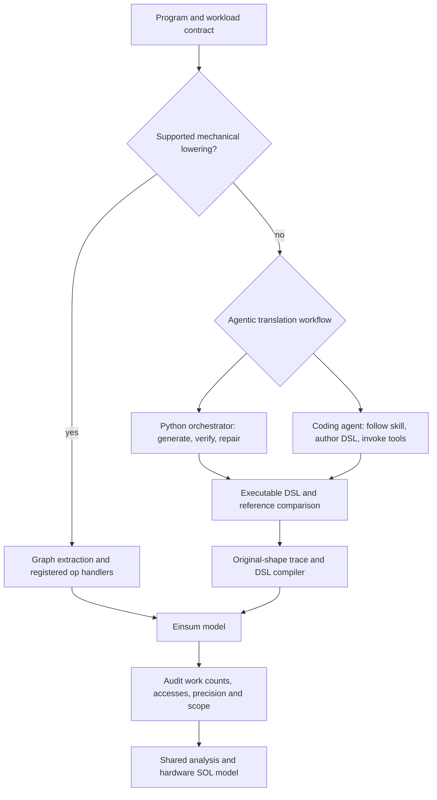

<!-- SPDX-FileCopyrightText: Copyright (c) 2025 NVIDIA CORPORATION & AFFILIATES. All rights reserved. -->
<!-- SPDX-License-Identifier: Apache-2.0 -->

# Route selection and the bounded fallback dispatcher

This page carries the routing contract and the `solar.frontend.dispatcher`
description that lived in the retired top-level `README_V2.md` (consolidated
2026-11-04). The surrounding material is now in [`../README.md`](../README.md),
[SOLAR_FLOW.md](SOLAR_FLOW.md), [SOLAR_V2_FLOW.md](SOLAR_V2_FLOW.md) and
[SOLAR_V2_OVERVIEW.md](SOLAR_V2_OVERVIEW.md) (which holds the "What must be
validated" table). Nothing below is new behaviour; it documents the shipped
`solar/frontend/dispatcher.py` and its tests.

## Choose a frontend

The diagram is the routing contract. `solar.frontend.dispatcher` implements
it as ONE bounded policy (`python -m solar.frontend.dispatcher run MODEL.py
--out-dir OUT [--route pure_skill|pythonic] [--definition DIR --dtype fp32]`;
library: `dispatch(DispatchRequest, DispatchPolicy, provider)`):

1. **Deterministic first.** PyTorch capture, the evidence-based route
   decision above, registered op-to-Einsum lowering, analysis and perf. A
   complete lowering is the result (`mechanical_ok`); the dispatcher records
   that this route performed no numerical comparison.
2. **Eligible failure -> automatic bounded agentic fallback.** An unsupported
   capture/lowering (router routes `agentic`/`unsupported`, a layer is not
   einsum-supportable, a stage reports `status: incomplete`) or a failed
   caller-supplied deterministic numerical validation records a concise
   `why` (`deterministic_limitation` + `fallback_reason`) and enters the
   SELECTED v2 route under `Budget(max_attempts, wall_seconds, max_requests,
   max_cost_usd)`. The deterministic failure receipt is retained verbatim.
3. **Data-dependent sparsity is agentic-by-default.** MoE/top-k routing,
   sparse attention and gather/scatter/masked-selection ops
   (`DATA_DEPENDENT_SPARSITY_OPS`, exact names, or a caller-declared
   `--sparsity-family`) bill dense mechanically and cannot establish
   measured density, so a v1 failure on such a row is the expected
   limitation, not a defect. Op-name membership is a conservative routing
   heuristic, not proof that the program is sparse: a dense identity gather
   is routed the same way, and masked/variable-length programs that use
   none of these names need the explicit declaration. The declaration takes
   precedence over detection and is carried through every deterministic
   outcome (raw sources, capture exceptions, stage errors). The
   deterministic attempt stays in the report; the row's SOL must come from
   the DSL-route sparse (measured-density) analysis, which the result names
   as `sol_source`. The dispatcher does not run `sol` itself.
4. **Infrastructure errors are never hidden by a fallback.** A deterministic
   timeout/OOM/host fault, or a stage fault such as a missing capture
   artifact, returns `deterministic_infrastructure_error` with a durable,
   unscored receipt (retained for retry). Agentic failures are classified by
   stage, exception type and HTTP status first and by message text last:
   provider authentication/transport faults are `infrastructure` (retained
   for retry, never scored); candidate-execution exceptions are candidate
   defects (`unsupported`, scored). Both count against the model-attempt
   bound. An infrastructure-only validation failure keeps the candidate in
   a pending-infrastructure state and re-validates the same bytes within
   the execution caps (`max_validation_retries`, a TOTAL persisted across
   `resume`, never reset) without a new model request; the candidate and
   adapter bytes are re-hashed before every validation attempt and different
   bytes are refused (`candidate_bytes_changed`); the ledger reports planned,
   model-attempts-used, scorable, pending-infrastructure and unresolved
   counts separately. What the total wall cap bounds, exactly: the deadline
   is evaluated from the monotonic clock with the persisted absolute deadline
   as a secondary bound, and the elapsed figure is never smaller than the
   epoch delta; the start persists (epoch, monotonic, pid, kernel boot id),
   plus the process INCARNATION identity (boot id, pid, kernel start time —
   an integer pid alone is reusable and proves nothing), so a `resume` in the
   same incarnation uses the monotonic clock directly and one in another
   process under the SAME boot id keeps monotonic continuity and must agree
   with the epoch delta within a small tolerance, while a different or
   UNKNOWN boot id on either side, a missing monotonic start (always
   required), a monotonic reading before the start, or a disagreement beyond
   the tolerance ends the dispatch as `clock_continuity_unknown`
   (infrastructure, unscored; there is no epoch-only fallback, and a
   wall-clock rollback is likewise a discontinuity); awaiting time counts
   across `resume`;
   the remaining time is forwarded to the Pythonic provider as its
   `verify_timeout` and to the pure-skill request (`deadline_utc`); capture
   is synchronous and checked after it returns; candidate validation is
   pre-empted only when a `verify_timeout` is set (forked pre-emption is
   never introduced by the dispatcher); and EVERY outcome that arrives after
   the deadline (a verified pass, a mismatch, or a deterministic success) is
   rejected as infrastructure, unscored, before any scoring.
5. **Both v2 routes, under their contracts.** `pure_skill` is a durable
   request/receipt boundary: the dispatcher writes `TRANSLATION_REQUEST.json`
   (source + sha256, shape, dtype, route, attempt, caps, prior candidate
   hashes, the why); the native coding agent writes the candidate and
   `TRANSLATION_RESPONSE.json`; `resume OUT` consumes it, refuses responses
   that do not echo the request id and source hash, then validates the
   candidate. A candidate whose bytes equal a known saved DSL
   (`--known-candidate`) or an earlier attempt is refused at the common
   validation boundary, whichever route produced it; byte inequality is not
   authorship proof, so the receipt says "byte-distinct from known saved
   DSLs", never "freshly generated". `pythonic` is a thin, tested shim over
   the in-process `solar.einsum_lib.pipeline.translate_file` (one bounded
   invocation per attempt, `max_retries=1`); it is NOT a re-wiring of the
   `TranslationAgent` repair loop into the dispatcher.
6. **The dispatcher validates every candidate itself** through
   `solar.translate.verify` under an explicit tolerance policy (`--rtol
   --atol`, else the selected `workload.jsonl` line's `tolerance`, else
   unresolved: the candidate still executes, but no pass/fail is admitted
   and the facade defaults are never substituted) and, with
   `--definition`/`--dtype`, emits the hash-bound receipt; a provider's own
   "verified" claim is never trusted. Before any pass is admitted the
   EXECUTED reference (the verifier's `reference_sha256`: what the adapter's
   `get_source()` returned, or the model text) must equal the requested
   source hash, as a checked assertion recorded on the verdict
   (`reference_binding`); an adapter embedding a changed reference is refused
   (`adapter_reference_mismatch`, carrying both hashes). That equality is
   necessary, not sufficient: on adapter routes the generated adapter may
   supply only the candidate side and input-generation metadata
   (`get_inputs()`, optional `REFERENCE_ENTRY`/`REFERENCE_ARGS`), never the
   reference computation together with the assertion identifying it. No
   generated code ever executes in the dispatcher's own process: the facade
   verifier itself runs in a child (`verify`, which also emits the sealed
   receipt into a STAGING path admitted only after the trusted gate passes),
   and the trusted proof is computed in further children. Every child is
   the installed comparator program `solar/frontend/_trusted_child.py`,
   executed FROM ITS INSTALLED PACKAGE PATH with `python -I -S` — never a
   string written at runtime and never a copy inside the artifact tree. The
   PARENT hashes that module together with the stdlib/numpy files it imports
   at dispatcher import, re-hashes them before AND after every phase
   (`trusted_program_tampered` fails closed), records the child's own hash
   report without trusting it, and computes the verdict digest itself over
   its own hashes of the artifacts. Every phase runs in its own SESSION
   (`start_new_session`) and its own private 0700 directory; after a phase
   that executed generated code the parent kills the whole session and
   verifies on `/proc` (session id, process group, and — the dispatcher is a
   child subreaper on Linux — any orphan that re-parented to it) that no
   descendant survived: `candidate_descendants_alive` refuses otherwise, and
   nothing produced by that phase is admitted. The trusted roots are computed
   ONCE in the parent from the LIVE interpreter — its configured stdlib and
   site directories (`sysconfig`, `site.getsitepackages()`, the user site
   when enabled, so a `pip install --user` runner image is covered), the
   directories the environment declares inside them (`.pth`, editable
   installs), the resolved origin of every third-party dependency this
   process already loaded, the installed site directories present on
   `sys.path`, and the pinned checkout — never PYTHONPATH as such, cwd, or
   the adapter's/candidate's directories — serialised with their hash into
   every phase's metadata and CONSUMED by the comparator and by the facade
   runner (`_runner.use_trusted_roots`), which no longer derive a second list
   of their own. Phases, in order: (1) `inputs` executes adapter code and
   writes the input snapshot from `get_inputs()`; the parent reads those bytes
   ONCE and holds them, with per-array hashes, as the frozen state — no child
   ever imports frozen state the candidate could reach. (2) `candidate` runs
   FIRST, in ITS OWN PROCESS (manager design ruling, round 9): the parent
   spawns ONE candidate process per launch with a fresh, empty, per-launch
   private working root (`mkdtemp` under the attempt directory, mode 0700)
   that contains ONLY that launch's inputs and the candidate source, with cwd
   set there and no path to any previous attempt directory, evidence
   directory or reference material. The inputs are parent-owned `.npy` files
   (mode 0400 while the candidate runs) that the wrapper maps READ-ONLY; an
   in-place write faults inside the candidate process and the candidate is
   refused (`candidate_mutated_inputs`, scored). The candidate returns outputs
   ONLY by writing a result file into its working root, which the parent reads
   after the process has EXITED; completion is established by the PARENT from
   the exit status and a parseable result — never by a token available inside
   the candidate process (there is no nonce). An early exit or missing result
   is `candidate_result_missing` (scored). RESULT CHANNEL (round 10, manager
   hardening rule): every path a candidate or adapter process may have
   written — its `report.json`, its result archive, the input snapshot, the
   staged receipt — is ingested by the parent through ONE helper: `lstat` of
   the directory entry, `open(O_RDONLY|O_NOFOLLOW|O_NONBLOCK|O_CLOEXEC)`,
   `fstat` of the DESCRIPTOR requiring a regular file, exactly one link, the
   parent's own uid, a size within a documented cap (report 1 MiB; result
   archives `DispatchPolicy.max_result_bytes`, default 1 GiB) and the same
   (dev, ino) as the directory entry, then a read bounded to cap + 1 bytes
   and a second `fstat` of the same descriptor that must show the same dev,
   ino, nlink, mode and uid, a regular file, and a size equal to the bytes
   read and within the cap (an append past EOF between the read and the
   re-check refuses; round 11); the whole step runs under the remaining
   dispatch budget (a helper thread joined with that bound, never less than a
   0.5 s grace while budget remains; once the dispatch deadline has passed
   nothing is opened or read and the result is refused). Attempt-visible
   records show of each ingest only a FIXED-SHAPE view — ok, file kind, the
   documented cap, timed_out and the problem text with numerals redacted —
   never the size read, the link count or the time bound (round 12, the review
   NUMERIC-FEEDBACK-30/C: the serialized length of the unredacted comparison
   report identified the hidden error through a four-value domain); the full
   ingest record stays in the private root and returns in the terminal
   receipt. A fifo, socket,
   device, symlink or directory at a
   result path, an oversize file or an identity mismatch is
   `candidate_result_missing` with the file type named — the parent never
   performs a blocking open of a candidate-controlled path and never follows
   a link there. The ingest happens BEFORE the private evidence root is
   unlocked. The report is parsed against a strict ALLOWLIST schema (known
   keys with typed values; unknown or mistyped keys are dropped and counted;
   no nesting beyond the schema) and only the re-serialised allowlisted
   values enter any record — never a merge of the raw object. No public
   record (DISPATCH_STATE, DISPATCH_RECEIPT, phase records) names the private
   root's PATH: they carry an opaque id and inode identity; the path lives in
   the root's own state file, and resume re-finds the root by identity. The
   artifact tree holds no alias of the reference. After the session boundary the
   parent re-hashes its OWN input files (still 0400) and checks their inode
   identity, mode and ctime against the pre-launch record; any difference is
   `candidate_mutated_inputs`. Scope, stated exactly: this certifies the
   observed END STATE of the parent's inputs (plus the inode-level write
   history the kernel records), not every intervening write; a private copy
   changed inside the candidate process cannot alter the parent's inputs and
   is not a purity violation of the inputs — the outputs are judged by the
   trusted comparison. (3) `reference` executes the ORIGINAL requested source
   bytes (hash-checked) AFTER the candidate session is dead and verified gone,
   under the guard, inside the dispatch's PARENT-PRIVATE EVIDENCE ROOT: a
   directory created exclusively per dispatch with mode 0700, outside every
   candidate working root, and LOCKED to mode 0000 while any process that
   executes generated code is alive (its inode identity and ctime are
   re-checked before it is unlocked; `evidence_root_tampered` refuses). The
   parent copies the reference outputs into that root with
   `open(O_WRONLY|O_CREAT|O_EXCL|O_NOFOLLOW, 0600)` to a fresh random filename
   and refuses the dispatch (`reference_material_retained`, infrastructure) if
   `fstat` does not show exactly one link to a regular file in that directory;
   it never writes reference bytes to any path a candidate process could have
   pre-linked, and never writes into a candidate working root after launch.
   Per-attempt comparison digests and `report_compare.json` live in the
   private root; no digest of reference bytes appears in any receipt or state
   file (the public verdict digest binds the program hash, the launch argv,
   the environment and the outcome, not the reference bytes). The seal before
   each launch still runs as defence in depth — it removes raw reference
   observations by name and by a census of every reference inode written this
   dispatch (a differently named hard link is caught) and refuses the launch
   if anything is retained — but the isolation above is the proof boundary,
   not the seal. Provenance is audited afterwards: a module counts as trusted
   only if it entered `sys.modules` through the import system under the guard
   (origin realpath under a trusted root, content fingerprint unchanged since
   import) or existed, unchanged and un-replaced, before generated code ran —
   a `__spec__` or `__file__` written by generated code establishes nothing
   (`reference_dependency_untrusted`, infrastructure, unscored). One descent
   rule (round 10, manager ruling after the r9 CI finding; stated precisely in
   round 11 from the runner traces): a submodule that an extension or package
   exposes — torch's Python code registers `torch._C._distributed_c10d`,
   `_distributed_rpc`, `_distributed_autograd` and `_autograd` in
   `sys.modules` after `torch._C` itself was loaded — is trusted ONLY when
   (a) its parent is a census-verified file module: it existed before
   generated code ran with its file unchanged, or the guard imported it during
   execution from under a trusted root with its file unchanged; (b) its name is
   the parent's name plus one component; (c) the object in `sys.modules` IS
   the very object the parent exposes as a module attribute (possibly under
   another attribute name) and, when the parent existed before generated code
   ran, the parent exposed that very object before too; (d) it names no file
   of its own: no `__spec__` origin other than None / "built-in" / "frozen",
   and either no absolute `__file__` (the relative markers `torch.ops` and
   `torch.classes` carry are not files) or a `__file__` that IS the parent's
   verified file — pybind11 ≥ 3.0 copies the parent's `__file__` onto every
   `def_submodule` module created after the parent initialised, which is how
   torch ≥ 2.9 registers the four names above; a `__file__` naming any other
   path refuses. A planted `torch._C.evil` fails the identity test and stays
   untrusted, with or without a copied `__file__`. The attribution
   (`extension_submodule_of`, `package_submodule_of`), the admitting basis of
   each (`attribution_basis`) and, for every refused module, a diagnostic
   naming the failed condition and the parent's census state
   (`census_diagnostic`) are recorded in the private receipt only; the public
   reason names the module and the failed condition's code. (4) `compare`
   never runs generated code: it reads the parent's private copies of the
   three artifacts by hash and compares under the approved rtol/atol plus a
   floor derived ONLY from the trusted outputs' dtypes; `success` is computed
   once from the comparison. Adapter-side dtype floors are diagnostics only
   (`tolerance_widening_rejected`). The dispatcher never calls a comparator
   for the trusted gate: it re-hashes the persisted arrays and computes the
   digest from its own constants. A disagreement is
   `trusted_reference_mismatch`; a reference the dispatcher cannot execute
   (ambiguous entry, resource, timeout) fails closed as
   `reference_unexecutable` (infrastructure, unscored) — a real CUDA kernel
   with no CPU-executable original is therefore not verifiable here, and is
   reported so rather than trusted through its adapter. Resume continuity
   (`clock_continuity_unknown`) requires boot id, pid, kernel start time and
   the persisted monotonic start on both sides, and refuses a monotonic
   reading before the persisted start on every branch. Remaining boundary,
   stated honestly: every child runs as the same OS user. Everything inside
   the artifact tree is untrusted by construction and nothing there is
   executed as the comparator. The private evidence root is unreadable by
   path while generated code runs, but the same user could reach reference
   material through means the lock does not cover — a file descriptor the
   parent holds open (it holds none during a launch), `ptrace` of the parent
   where the system allows it, or write access to the INSTALLED PACKAGE (the
   comparator module and the hashed files it imports are re-hashed around
   every phase, other installed files are not) — and a process the kernel
   does not report under the phase's session, process group or re-parented
   to the dispatcher is outside the verified kill. Numerical feedback
   (round 10, manager ruling numeric-feedback-30): while the dispatch
   runs, attempt-visible state (`DISPATCH_STATE.json`) carries only pass/fail
   per output (`outputs_pass`) and the tolerance policy; the error statistics
   (`max_abs_error`, per-output errors) are written to the private evidence
   root and surface ONLY in the final `DISPATCH_RECEIPT.json` and the returned
   result, after the dispatch has ended, when no further attempt can read
   them. A RESUMABLE outcome — `awaiting_agent`, or an infrastructure failure
   with a retained candidate that `resume` re-validates — is not the end of
   the dispatch: its `DISPATCH_RECEIPT.json` and returned result carry the
   same attempt-visible view as the state file (round 11, the review
   NUMERIC-FEEDBACK-30/A; the receipt says so in `numeric_statistics`), and
   the statistics are restored only in the terminal receipt (final verdict,
   exhausted attempts, hard failure). The public verdict digest
   (`verdict_sha256`) is computed over the attempt-visible verdict — statistics
   emptied, numerals in free text redacted — so it depends on no withheld
   field; the digest over the full verdict lives in `verdict_private.json`
   only (round 11, NUMERIC-FEEDBACK-30/B). The rule, stated once (round 12,
   NUMERIC-FEEDBACK-30/C): NO metadata derived from the unredacted comparison
   report or from a private verdict appears in an attempt-visible record —
   not a size, a count, a digest or a timing. Every validation record passes
   through one projection (`_attempt_visible`) before it reaches the state
   file, a resumable receipt or a resumable result: statistic keys emptied,
   numerals in verdict texts / ingest problems / stderr tails redacted,
   `result_ingest` reduced to the fixed public shape, durations (`seconds`)
   withheld; the full record is stashed privately and restored only in the
   terminal receipt. Round 13 (NUMERIC-FEEDBACK-30/D) makes the attempt-visible
   record a CONSTANT-SHAPE document: the compare verdict always carries its
   eight public keys (statistics and `vacuous_outputs` present and null,
   `tolerance` always its five keys), every phase's `report_schema` carries
   no parse counter (nullable fixed view), kernel ids (`pid`/`sid`/`pgid`/
   `leader_pid`) and inode facts (`ino`/`ctime_ns`/`mtime_ns`) are withheld.
   A non-finite error statistic (finite operands can overflow: 1e308 −
   (−1e308)) is written by the compare child as one of the canonical tokens
   `"inf"`/`"-inf"`/`"nan"`, which the parent's allowlist parser accepts, so
   the verdict parses whole and the child's and the parent's digests agree —
   nothing is waived. Every check on the compare child's verdict (unparsed or
   dropped fields, re-hash, digest, consistency) is ONE public class
   (`trusted_verdict_unverifiable`) with ONE constant public message; which
   check refused is in the terminal receipt and `verdict_anomalies.json` in
   the private root only. A failing candidate against an all-zero (vacuous)
   reference is the mismatch class; vacuousness is decided only for a passing
   candidate (`no_proof`). Wall-clock telemetry read after comparison work —
   `wall_seconds_elapsed` in the state file and in a resumable ledger, the
   request's `wall_seconds_remaining` — is withheld (null) until the terminal
   receipt; `deadline_utc` and the caps are policy fixed at dispatch start
   and the providers derive their own bound from the deadline. Two property
   tests state exactly what they prove. The finite-domain test: four
   dispatches differing only in a finite hidden error publish state,
   intermediate receipt and result whose PARSED documents are equal after
   normalising the listed independent fields. The whole-surface test: five
   dispatches over every statistic class (finite 1.0 and 5e307, inf by
   overflow, nan, the all-zero reference; the reviewer's two fixtures verbatim —
   a reference carrying inf itself yields the same canonical token as the
   overflow case and is not run) publish byte-identical DISPATCH_STATE.json,
   intermediate DISPATCH_RECEIPT.json, next TRANSLATION_REQUEST.json, every
   other public JSON file and the returned result — each file is the canonical
   serialisation of its document, the normalised documents are byte-identical
   including key order, and the raw size differences equal the width
   differences of the normalised values (dispatch-start clock readings,
   kernel ids, inode numbers, the two pre-comparison-bound digests, random
   tokens and names) — plus an identical public tree listing (paths, types,
   modes, link counts, sizes of every non-JSON file) and identical dispatcher
   log lines; file timestamps are excluded (clock readings). Not claimed:
   identity across hosts or paths, or a timing side channel measured with the
   attempt's own clock. Residual, stated
   plainly: a candidate can still learn pass/fail per
   output per attempt — one bit per output per attempt — from the public
   state. A stricter boundary needs OS-level sandboxing (a separate user,
   namespaces or a container). The
   Pythonic provider's GENERATION step (`translate_file`) still runs the
   pipeline's own self-check in the dispatcher process; its result is never
   trusted, the trusted gate above
   decides. Vacuous or
   shape-only passes and refused receipts are `no_proof`. When the tolerance
   policy is unresolved the candidate is still executed diagnostically with
   the facade's defaults so candidate defects surface, but that execution
   admits nothing: no pass, no mismatch, `tolerance_unresolved`.
   `sol_source.status` is `ready` only when that sealed receipt exists; a
   numerical pass without receipt inputs is `blocked`, because
   `sol(strict=True)` refuses a missing receipt. Any dispatcher or
   receipt-storage fault leaves a durable unscored `DISPATCH_RECEIPT.json`
   (written atomically) and retains the candidate.
7. **Fail closed, no API by default.** Missing input, missing provider,
   missing budget stop the dispatch with the deterministic failure retained.
   The default provider is none. `pythonic` requires an explicit `--api-key`
   (enforced in the method that calls the pipeline; the dispatcher never
   reads `OPENAI_API_KEY` or key files) AND a ledger reservation handle
   passed in by the caller. Every transport request is authorized and its
   cost preauthorized at the actual call boundary: the invocation prepays
   one request, and `TranslationAgent._complete` charges the installed
   transport budget before each further call (model fallback, rate-limit
   retries and the terminal call after fallback exhaustion included), so an
   unaffordable request is refused before it is sent; the debit survives
   every post-call exception, and results and receipts are built only after
   accounting. Request and cost debits are PRIMITIVE: one row per transport
   request written at call issue, before any response is parsed; usage
   reconciliation is a separate, total step (an unparseable usage object is
   kept verbatim as `usage_unparsed` and never disturbs the debit), cost
   annotations such as an overrun live outside the request count, and the
   budget's serialization never raises. `--cost-per-request-usd` is a
   per-request HARD bound: a reported cost must be a finite non-negative
   number (otherwise `cost_malformed`: infrastructure, unscored, the
   pre-transport bound stays debited, never a credit); once a measured cost
   has been reconciled it is the authoritative debit in both the reservation
   and the dispatcher ledger, whatever fails afterwards; measured usage (a
   finite `cost_usd`, or parsed tokens times `cost_per_1k_tokens_usd`) is
   reconciled against it, and an overrun beyond the bound or beyond the
   remaining cost cap refuses admission (`cost_cap_exceeded`). Unmeasured
   usage is admitted ONLY when the caller established that explicit bound
   before the call and the provider exposed no cost channel at all; the
   bound used is recorded (`cost.bound_used_usd`). Without an explicit bound
   the result is refused (`cost_unbounded`: reserving the remaining balance is
   not an upper bound), and a provider that itself reports the cost as
   unavailable under a finite cost cap is refused likewise. Without
   `--cost-per-request-usd` each request still preauthorizes the entire
   remaining reservation, so a zero-dollar reservation never calls.

Limits, stated: only `pytorch` sources have a mechanical frontend (other
source types are recorded unsupported and go straight to the selected
agentic route); the mechanical result carries no numerical validation unless
the caller supplies a validator; `sol` remains a separate, caller-owned step
(strict mode with the emitted receipt). Neither problem 119 nor any of the
20 Lite shape-0 rows has been run through this dispatcher; its evidence is
the pt_matmul fixture. Tests: `tests/test_fallback_dispatcher.py` and the
`tests/test_fallback_dispatcher_review7_*controls.py` modules (CPU, mocked
providers/transports, fake agent, real verification on the pt_matmul and
cuda_scale fixtures).

| Route | Current implementation | When to use it |
|---|---|---|
| Mechanical | PyTorch graph extraction through torchview, then registered op-to-Einsum handlers | The graph and all relevant operators are supported and their semantics and accounting are understood |
| Agentic, Pythonic | `solar.cli.toDSL_model`, `TranslationAgent`, explicit `solar.cli.translate api`, or `solar.estimate` modes `v1`/`v2` | Python owns generation, execution checks and bounded repair; inference API access is explicitly enabled (mode `v2` instead consumes agent-authored IR) |
| Agentic, pure skill | Coding agent follows `skills/verified-translation`, authors an adapter and DSL, then invokes deterministic verification, receipt and analysis tools | Agent reasoning is outside SOLAR's Python orchestrator; the same verifier, compiler and backend are reused |

The mechanical frontend is PyTorch/torchview-based. Other graph-compiler
frontends are extension points, not evidence of implemented FX, export, MLIR
or JAX lowering. JAX, Triton and CUDA source support in the agentic path is
not mechanical compilation of those languages: each case needs an executable
reference and a supported adapter contract. Source readability is not
universal support.

## Implementation and release boundary

The commands above exist in the shipped source and were executed on its
release checks (2026-10, x86_64, Python 3.10). Their existence does not certify all
benchmark translations. Historical campaign tallies (such as 235/235
SOL-ExecBench verifications) are numerical results at capped shapes from
earlier commits and hosts; they are not re-run per checkout and do not
certify counts or SOL. The mechanical `examples/Matmul` learned-weight
example reports the correct 1,048,576 MACs at this base through an in-process
parameter-capture shim; an earlier audit recorded a 4x undercount with an
unpatched torchview, and clean-install behaviour of the shim was not
exercised for this documentation (see the
[mechanical page](SOLAR_V1_FLOW.md#learned-parameter-example-and-dependency-caveat)).

Direct DSL-to-Timeloop export still needs a validated schema adapter. The
mechanical unknown-op `--enable-llm-agent` option is handler generation; it does
not automatically apply the v2 execution-validation contract. Additional mechanical frontends, broader numerical coverage and calibrated
accounting are release work, not implied by the two-path diagram; the
dispatcher above routes and validates, it does not widen mechanical support.

