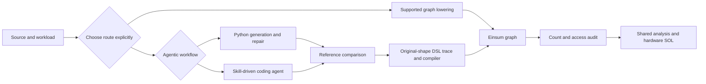

<!-- SPDX-FileCopyrightText: Copyright (c) 2025 NVIDIA CORPORATION & AFFILIATES. All rights reserved. -->
<!-- SPDX-License-Identifier: Apache-2.0 -->

# SOLAR v2 flow and route selection

SOLAR v2 uses two frontend paths: mechanical lowering for supported programs,
and execution-validated agentic translation for unsupported programs. The
agentic path has two workflows: Python-orchestrated and skill-driven. Both
frontend paths feed Einsum models into shared analysis and hardware prediction.

| Route | Entry points | Output | Required evidence |
|---|---|---|---|
| Mechanical | `solar.cli.process_model`, then `solar.cli.toeinsum_model` | PyTorch graph, then Einsum graph | Supported graph/operators; audited semantics and cost rules |
| Agentic: Python | `solar.cli.translate api` or `solar.cli.toDSL_model` | Generated DSL, verification output, trace artifacts | Explicit API use; recorded reference, inputs, failures and repairs |
| Agentic: skill | Coding agent follows `skills/verified-translation`; `translate scaffold`, `verify`, `sol` assist | Authored DSL, verification output, trace artifacts | Agent actually authors the model; deterministic checks and original-shape analysis |

Routing can now be computed from evidence:
`python -m solar.frontend.router <pytorch_graph.yaml>` (or
`solar.frontend.router.decide_from_graph`) routes `mechanical` only when every
compute node is in the bounded supported set AND the graph passes integrity
and semantic checks: every edge resolves to an existing node, each operand
occurrence carries both its shape and its edge, the full matmul output shape
(batch broadcast and vector cases) is recomputed and compared, linear
orientation/output/bias and unambiguous operand roles (every operand used
exactly once) and sum reduction shapes are validated, and
elementwise/broadcast and reshape-family shape rules hold.
Anything else routes `agentic`/`unsupported` with recorded reasons — offline
and deterministic, no credentials, no paid APIs. `scaffold` creates files and
a checklist; it does not invoke an agent. `sol` by default runs downstream
tools WITHOUT enforcing a verification receipt (legacy, unvalidated); the
strict path `sol(..., strict=True, receipt=..., source_path=...)` refuses to
run unless a receipt whose evidence was captured inside the actual
verification execution (see `solar.translate.receipts`) hash-matches the
current source/DSL/definition bytes, the re-derived reference source the
adapter yields right now (so an externally read `reference.py` is bound,
not only the adapter bytes), the reference's local execution dependencies
(adapter-directory modules imported during preparation, compiled from
current source bytes via a controlled loader that bypasses bytecode caches —
the adapter/model file itself included, with the executed bytes required to
equal the hashed source bytes; an unprovable closure refuses strict
qualification), the exact selected
workload and the
selected analysis precision — a passing run cannot be rebound to changed
bytes, at emission or at strict entry. Mechanical graph artifacts carry
source + capture-identity provenance, and resume reuses them only on a full
match.
The mechanical `--enable-llm-agent` handler fallback is not a substitute for
execution-validated agentic translation.

The filenames [SOLAR_V1_FLOW.md](SOLAR_V1_FLOW.md) and
[SOLAR_V2_FLOW.md](SOLAR_V2_FLOW.md) remain stable links for the existing mechanical
and DSL commands. They are implementation lineage labels; they do not partition
the v2 product into a supported frontend and a retired frontend.

Use separate output directories per route, workload and accounting convention.
Align shape, precision, hardware, fusion, cold/warm inputs and sparse scope
before comparing estimates. Preserve failures, skips, timeouts and denominators.
Output agreement does not establish operation counts or memory traffic.

Direct DSL-to-Timeloop export is not yet supported without a schema adapter;
only compatible mechanical graphs have the existing export path.

Read [implementation contracts](SOLAR_V2_CONTRACTS.md),
[design rationale](SOLAR_V2_OVERVIEW.md), and [SOL interpretation](SOL_GUIDE.md).
